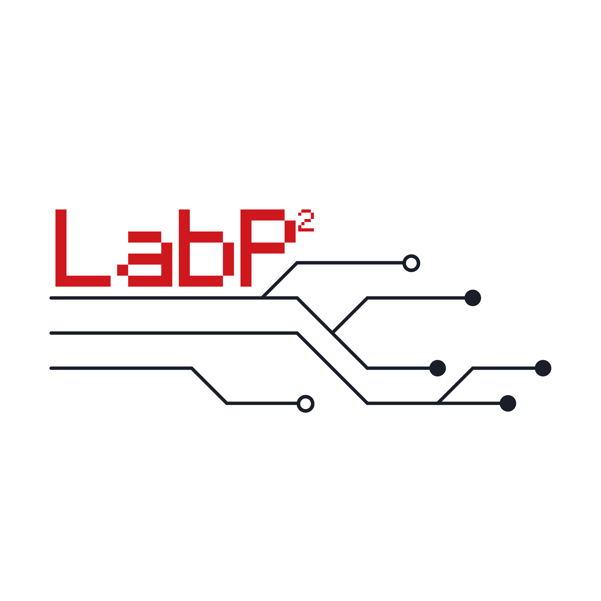

# Gestão Legal UFMG

<p align="center">
  
</p>

Sistema de Gestão de Assistências Judiciárias e Escritórios de Advocacia Modelo

---

## Sobre

Sistema desenvolvido pelo projeto de extensão da Faculdade de Direito da UFMG [Gestão Legal](https://gestaolegal.direito.ufmg.br/) para auxiliar o gerenciamento e funcionamento da [Divisão de Assistência Judiciária - DAJ](https://daj.direito.ufmg.br/).

O **Gestão Legal é uma iniciativa do LAB P² — Laboratório de Tecnologias Públicas para o Setor Público**, da Faculdade de Direito da UFMG.

O laboratório desenvolve e integra tecnologias livres e abertas para atender às necessidades das instituições públicas. Reúne estudantes, professores e servidores em projetos que articulam ensino, pesquisa, extensão e gestão, promovendo formação interdisciplinar, compartilhamento de soluções e autonomia tecnológica. [Conheça o LAB P²](https://labp2.direito.ufmg.br/o-projeto/).

<table>
  <tr>
    <td align="center"><a href="https://labp2.direito.ufmg.br/"></a></td>
    <td align="center"><a href="https://www.direito.ufmg.br/"></a></td>
    <td align="center"><a href="https://ufmg.br/"></a></td>
  </tr>
  <tr>
    <td align="center">LAB P²</td>
    <td align="center">Faculdade de Direito</td>
    <td align="center">UFMG</td>
  </tr>
</table>

### Funcionalidades

- Gestão de casos jurídicos e processos
- Cadastro e acompanhamento de clientes
- Controle de orientações jurídicas
- Gerenciamento de equipe (orientadores, estagiários, colaboradores)
- Acompanhamento de eventos e prazos processuais
- Upload e gerenciamento de documentos
- Organização dos atendimentos por unidade
- Escalas de plantão, fila de atendimento e registro de presença

---

## Requisitos

- **Python 3.11+**
- **Docker** e **Docker Compose** (recomendado)
- **Node.js 24** (apenas para desenvolvimento do frontend, como nas imagens Docker)

---

## Instalação

### Desenvolvimento local

O repositório tem dois Composes independentes:

| Arquivo | Uso |
|---|---|
| `docker-compose.dev.yml` | Código local, hot reload, MySQL e Mailpit. |
| `docker-compose.yml` | Produção ou QA, com imagens publicadas no GHCR e volumes externos. |

Não é necessário criar `docker-compose.override.yml`. Se ainda existir um
antigo, arquive-o fora do checkout e use os comandos com `-f` abaixo; não
combine os dois arquivos. O Compose da fusão fica no
[repositório de fusão](https://github.com/gestaolegalufmg/gestaolegal-fusao).

```bash
git clone https://github.com/gestaolegalufmg/gestaolegal.git
cd gestaolegal
cp .env.example .env
# Edite credenciais, JWT_SECRET_KEY e ADMIN_SETUP_TOKEN.
# Para executar seed pelo host, configure FLASK_ENV=development no .env.
make up
# Equivale a:
# docker compose -f docker-compose.dev.yml up -d --build
```

Frontend: <http://localhost:5001>; API: <http://localhost:5000>;
Mailpit: <http://localhost:8025>. As portas são configuradas por `WEB_PORT`,
`APP_PORT`, `DB_PORT` e `MAILPIT_UI_PORT`. Para manter o frontend em 5002,
use `WEB_PORT=5002 make up` e a mesma variável nos próximos comandos.
Crie o administrador em `/setup-admin` com `ADMIN_SETUP_TOKEN`.

O desenvolvimento força o uso do Mailpit e monta os anexos em `./uploads`
(ou `DEV_UPLOADS_PATH`). O banco fica no volume `<projeto>_mysql_data`.
Para migrar de um ambiente antigo, confira os mounts existentes antes de
subir: se os anexos estavam em um volume nomeado, copie-os para a pasta de
desenvolvimento preservando os arquivos. O seed não roda automaticamente.

### Produção e QA

Ambos usam `docker-compose.yml`; mudam o `.env`, o projeto, os volumes e a
versão publicada. Defina `IMAGE_TAG` com uma tag ou SHA disponível **nas duas
imagens** (`gestaolegal-api` e `gestaolegal-web`). Não há build no servidor.

Para uma **instalação nova**, crie os volumes cujos nomes foram definidos no
`.env` (exemplo: `gestaolegal_mysql_data` e `gestaolegal_uploads`):

```bash
docker volume create gestaolegal_mysql_data
docker volume create gestaolegal_uploads
docker compose -f docker-compose.yml config --quiet
docker compose -f docker-compose.yml pull
docker compose -f docker-compose.yml up -d
```

Em instalação existente, use os volumes que já contêm os dados. Não crie
volumes vazios como substitutos. As portas são locais (`127.0.0.1`); o proxy
HTTPS, como o Caddy de glteste, fica no servidor.

QA pode habilitar `COMPOSE_PROFILES=mailpit,adminer`, com SMTP apontando para
`mailpit:1025`, sem SSL/TLS. Produção pode usar SMTP externo ou o profile
`mail` do Postfix; veja [E-mail](docs/email.md).

**Antes de substituir o Compose de glteste**, siga a transição de serviços e
volumes em [Implantação](docs/implantacao.md). Os serviços antigos se chamam
`qa_*`; os novos são `web`, `api`, `db`, `migrate`, `mailpit` e `adminer`.

---

## Dados de demonstração (seed)

Após aplicar as migrations, execute o seed direto no banco, sem precisar da API:

```bash
make seed ARGS="--dry-run"  # simula a carga e faz rollback
make seed                 # grava os dados
make seed ARGS="--unidade BH"  # opcional: apenas uma unidade ativa
```

O comando usa `uv` e lê `DB_HOST`, `DB_PORT` (padrão `3306`), `DB_NAME`,
`DB_USER` e `DB_PASSWORD` do ambiente ou do `.env` da pasta atual. Para executar
no host com MySQL no Docker, use `DB_HOST=127.0.0.1 make seed` e a porta publicada.
Para executar dentro do container, após `make up` (que aplica as migrations):

```bash
docker compose -f docker-compose.dev.yml exec api python scripts/seed_database.py --dry-run
docker compose -f docker-compose.dev.yml exec api python scripts/seed_database.py
```

O script `scripts/seed_database.py` cria quatro usuários compartilhados e,
por unidade ativa, **20 atendidos (10 deles assistidos)**, dois casos com processos, quatro eventos,
duas orientações jurídicas, dois lembretes e uma escala com duas marcações.
Os dados são fictícios. Usuários e atendidos recebem CPFs sintéticos, distintos
e com dígitos verificadores válidos; isso não comprova inscrição real. Processos
não têm número judicial real. Os nomes e demais textos exibidos não contêm “Seed”.
Não são criados anexos nem enviados e-mails. As unidades vêm das migrations.

Contas: `admin@ufmg.br`, `orient@ufmg.br`,
`estag_direito@ufmg.br` e `colab_ext@ufmg.br`.
A senha inicial é `123456`, configurável por `SEED_PASSWORD`.
Reexecutar reconhece os identificadores da versão antiga, remove seus rótulos
“Seed” e substitui CPFs zerados pelos sintéticos, preservando IDs, vínculos,
senhas e outros campos editados. Não é preciso apagar o banco. Datas de
novos registros são relativas à execução; reexecutar não renova a agenda.
Não altere os identificadores do seed (e-mails, descrições e nome da escala)
se quiser preservar a deduplicação. Execute apenas uma instância por vez.

A carga é transacional: uma falha desfaz todas as inserções daquela execução.
`--dry-run` também pode consumir valores de auto incremento no MySQL, embora
não persista registros. Use apenas em desenvolvimento/testes; a execução é
bloqueada com `FLASK_ENV=production`. O script não cria nem altera o schema.
O seed via API existente, `scripts/seed_local.py`, continua disponível para
cenários que precisam exercitar endpoints e uploads.


### Reset automático do banco de demo

`scripts/reset_demo.sh` para a API, **apaga e recria o banco inteiro**, aplica
as migrations e executa `seed_database.py`. As contas e senhas voltam aos valores
do seed a cada execução. O usuário MySQL precisa de permissão para `DROP` e
`CREATE` no banco configurado.

Para usar o reset com o Compose de desenvolvimento, defina
`RESET_COMPOSE_FILE=docker-compose.dev.yml`; por padrão ele usa o Compose de
implantação. Nunca rode o reset sobre o acervo da fusão.

No `.env` exclusivo da demo, configure `FLASK_ENV=development` ou `testing` e
`DEMO_DB_NAME` com o mesmo valor de `DB_NAME`. Essa confirmação é obrigatória.
O script recusa ambientes de produção e bancos de sistema. Dentro do Docker,
`DB_PORT` deve ser a porta interna do MySQL (`3306`), mesmo que a porta publicada
no host seja outra.

Com a stack já iniciada e a imagem da API atualizada com os scripts, execute no
host (requer Bash, Docker Compose e `flock`):

```bash
/opt/gestaolegal/scripts/reset_demo.sh
```

Para agendar às 00h, 06h, 12h e 18h, no fuso do servidor, adicione ao `crontab`
de um usuário com acesso ao Docker e escrita no checkout/log:

```cron
PATH=/usr/local/sbin:/usr/local/bin:/usr/sbin:/usr/bin:/sbin:/bin
0 */6 * * * /opt/gestaolegal/scripts/reset_demo.sh >> /opt/gestaolegal/reset-demo.log 2>&1
```

Ajuste o caminho ao checkout da demo. Para a stack de QA, cujo serviço se chama
`qa_backend`, use `RESET_API_SERVICE=qa_backend` antes do comando. Se o arquivo
Compose tiver outro nome, informe também `COMPOSE_FILE` com seu caminho absoluto.
O script usa o `.env` e o Compose do checkout, independentemente da pasta atual.

Há bloqueios contra resets simultâneos no host e no MySQL. A API fica indisponível
durante o reset; se ele falhar, permanece parada. Corrija a causa e execute o
script novamente. A exclusão do banco não tem rollback. Os arquivos de anexos
no volume permanecem no disco, mas seus registros no banco são apagados.
O script não instala o cron automaticamente.

---

## Documentação

- 📖 [Wiki do Projeto](https://github.com/gestaolegalufmg/gestaolegal/wiki) - Documentação completa
- 🏗️ [Arquitetura](https://github.com/gestaolegalufmg/gestaolegal/wiki/Arquitetura) - Detalhes técnicos e stack
- 🔧 [Guia de Contribuição](CONTRIBUTING.md) - Como contribuir
- [Problemas conhecidos](docs/known_issues.md) - Limitações atuais e correções já entregues
- 🐛 [Reportar Issues](https://github.com/gestaolegalufmg/gestaolegal/issues) - Bugs e melhorias

---

## Contribuindo

Contribuições são bem-vindas! Por favor:

1. Leia o [guia de contribuição](CONTRIBUTING.md)
2. Crie uma branch para sua feature
3. Faça commit das mudanças
4. Abra um Pull Request

---

## Licença

Este projeto está licenciado sob os termos especificados no arquivo [LICENSE](LICENSE).

---

## Suporte

- **Issues:** [GitHub Issues](https://github.com/gestaolegalufmg/gestaolegal/issues)
- **Wiki:** [Documentação](https://github.com/gestaolegalufmg/gestaolegal/wiki)
- **Site:** [gestaolegal.direito.ufmg.br](https://gestaolegal.direito.ufmg.br/)

---

**Status:** Em desenvolvimento ativo — versão 3.0

Uma iniciativa do [LAB P²](https://labp2.direito.ufmg.br/), da [Faculdade de Direito da UFMG](https://www.direito.ufmg.br/).
